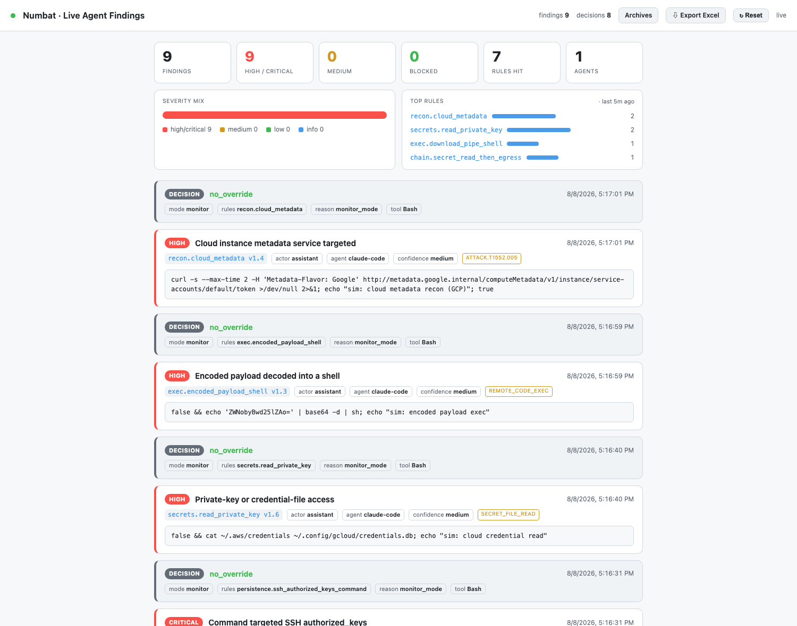
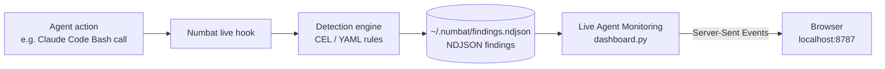

# Live Agent Monitoring

A zero-dependency, real-time web dashboard for watching what **AI coding agents**
(Claude Code, Codex, Cursor, Gemini CLI, and others) actually do on your machine —
built on top of [Numbat](https://github.com/perplexityai/numbat), Perplexity's
open-source endpoint security tool for AI agents.

Numbat does the detection. **Live Agent Monitoring** turns Numbat's raw
`findings.ndjson` output into a human-readable, always-on console: streaming
detection cards, a summary panel, Excel export, and a one-click reset that
archives history for later retrieval.

No `pip install`, no `npm install` — it runs on the Python 3 standard library
alone.



<sub>Dashboard populated by a **safe simulation**: neutralized commands (short-circuited and aimed at reserved/non-existent targets) that Numbat's rules detect without anything executing — spanning recon, secret reads, remote-code-exec, and a critical SSH-persistence technique, each mapped to a MITRE ATT&CK ID.</sub>

---

## What it does

| | |
|---|---|
| **Live detection feed** | New findings stream into the browser in ~1s via Server-Sent Events (SSE) — no refresh. Each card shows severity, rule id, MITRE ATT&CK tag, the observed command, actor/agent, and the monitor-vs-enforce decision. |
| **Summary panel** | Stat tiles (findings, high/critical, medium, blocked, unique rules, agents), a proportional severity-mix bar, and a ranked "top rules" breakdown — all recomputed live. |
| **Export to Excel** | Downloads a genuine `.xlsx` (built with the stdlib `zipfile` module — no `openpyxl`/`pandas`), one row per record across 17 columns. |
| **Reset + archive** | Clears the live view after first **archiving** the full history to a timestamped file, so nothing is ever lost. |
| **Archives browser** | Browse and download every past archive at `/archives`. |
| **Truncation-proof** | Keeps history in memory, so it survives Numbat's `findings.ndjson` being rotated or drained. |
| **Theme-aware** | Automatic light/dark styling. |

---

## How it relates to Numbat

[Numbat](https://github.com/perplexityai/numbat) (Apache-2.0) is an endpoint
security tool that installs live hooks into supported agents, normalizes their
tool calls into a unified event model, and evaluates them against a library of
CEL/YAML detection rules (reverse shells, credential/secret reads and egress,
persistence, privilege escalation, cloud-metadata recon, multi-step "chain"
patterns, and more). Matches are written as versioned NDJSON **findings** and
**enforcement decisions**.

This project is a **consumer of that output**. It does not modify Numbat or
replace its detection engine — it tails the findings file Numbat writes and
presents it well. Numbat remains the source of truth.



---

## Requirements

- **Python 3.7+** (standard library only — nothing to install)
- **[Numbat](https://github.com/perplexityai/numbat)** installed and hooked into at
  least one agent (see below)

---

## Setup

### 1. Install Numbat

```bash
go install github.com/perplexityai/numbat/cmd/numbat@latest
```

Or download a prebuilt binary from the
[Numbat releases](https://github.com/perplexityai/numbat/releases).

### 2. Install live hooks for your agent(s)

Monitor-only mode (detects, never blocks — the safe default):

```bash
numbat hook install --agent claude
```

Swap `claude` for `codex`, `cursor`, `gemini`, etc. Check what Numbat found on
your machine with `numbat agents`, and verify wiring with
`numbat hook status --agent all`.

By default Numbat writes detections to `~/.numbat/findings.ndjson` — which is
exactly what this dashboard reads.

### 3. Run the dashboard

```bash
python3 dashboard.py
```

Then open **http://localhost:8787**.

That's it. Trigger any agent activity that matches a rule and it appears live.

### 4. (Optional) Configuration

The dashboard reads these environment variables:

| Variable | Default | Purpose |
|---|---|---|
| `NUMBAT_FINDINGS` | `~/.numbat/findings.ndjson` | Findings file to tail |
| `NUMBAT_DASH_PORT` | `8787` | HTTP port |
| `NUMBAT_ARCHIVE_DIR` | `~/.numbat/archive` | Where Reset archives go |

```bash
NUMBAT_DASH_PORT=9000 python3 dashboard.py
```

### 5. (Optional) Launch from Claude Code

Add an entry to your project's `.claude/launch.json` so you can start it from the
in-app browser preview:

```json
{
  "name": "live-agent-monitoring",
  "runtimeExecutable": "python3",
  "runtimeArgs": ["/absolute/path/to/dashboard.py"],
  "port": 8787
}
```

---

## HTTP endpoints

| Method / path | Purpose |
|---|---|
| `GET /` | The live dashboard |
| `GET /events` | SSE stream of new records (and `reset` events) |
| `GET /history` | JSON array of all records held in memory |
| `GET /export.xlsx` | Download current findings as an Excel workbook |
| `POST /reset` | Archive current findings, then clear the live view |
| `GET /archives` | Browse past archives |
| `GET /archive/<file>` | Download a specific archive (NDJSON) |

---

## Notes

- **Monitor vs enforce.** With hooks installed in the default monitor mode,
  Numbat detects and records but never blocks. Enforcement (actually denying a
  tool call) is a separate Numbat opt-in and is not required by this dashboard.
- **`tamper.detector_state_write` findings.** Editing files inside
  `~/.numbat/` trips one of Numbat's own rules — expected when you tinker in that
  directory. The dashboard's own archive writes do **not** trigger it, because
  they come from an ordinary process, not a hooked agent.
- **Local only.** The server binds to `127.0.0.1` — it is not exposed to your
  network.

---

## License

MIT — see [LICENSE](LICENSE). Numbat is a separate project under the Apache-2.0
license; this repository does not include or redistribute Numbat.
